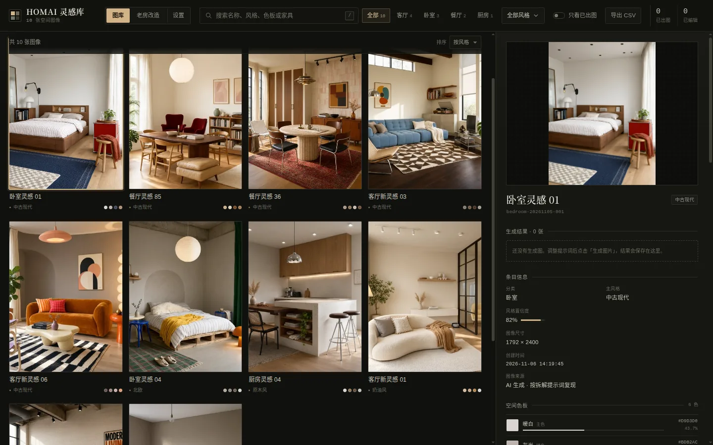
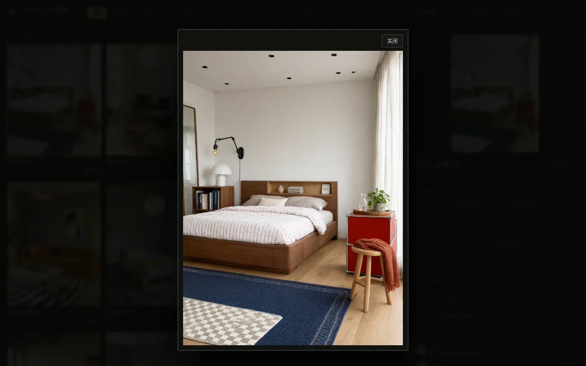
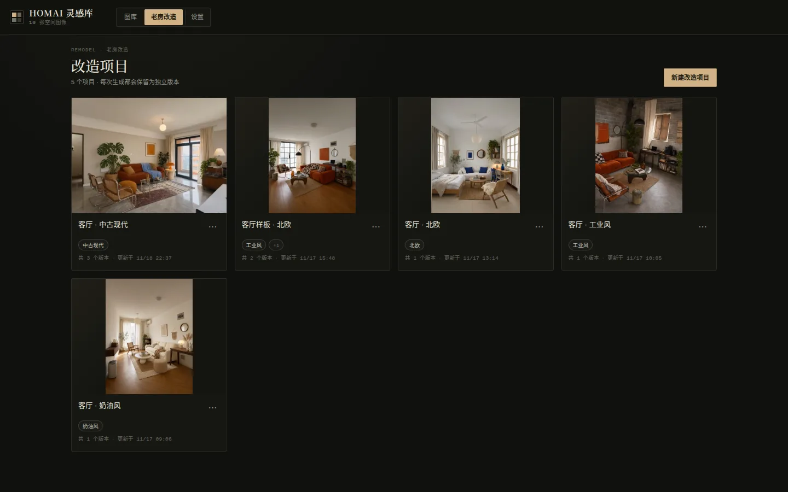
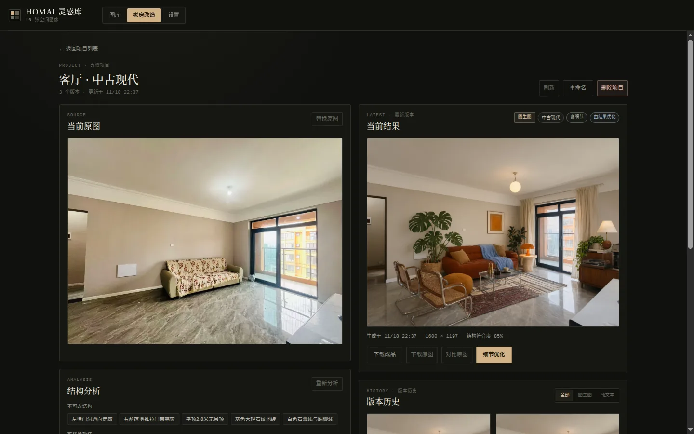
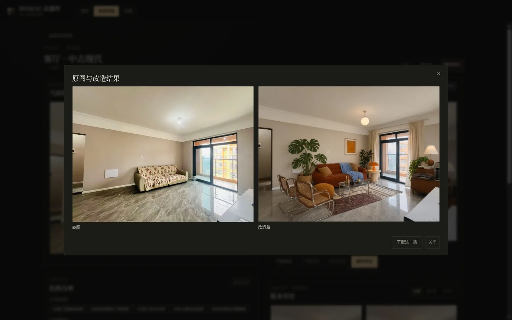
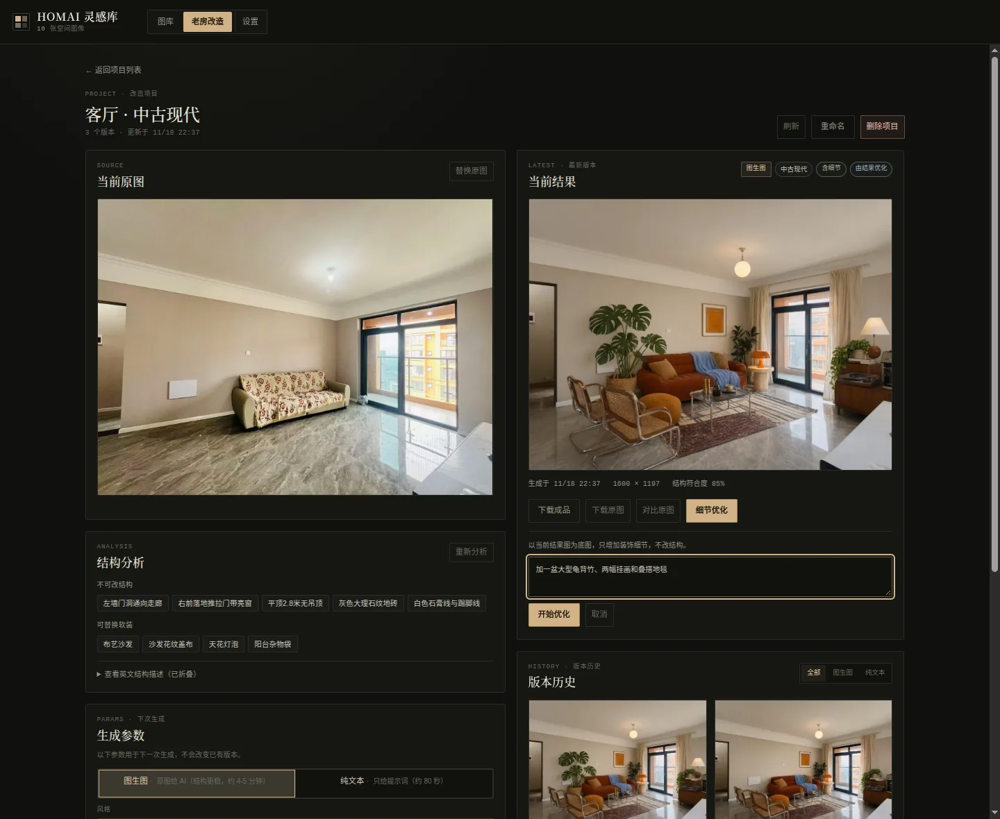
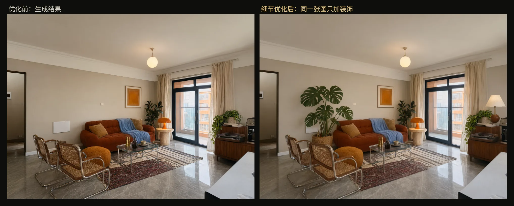
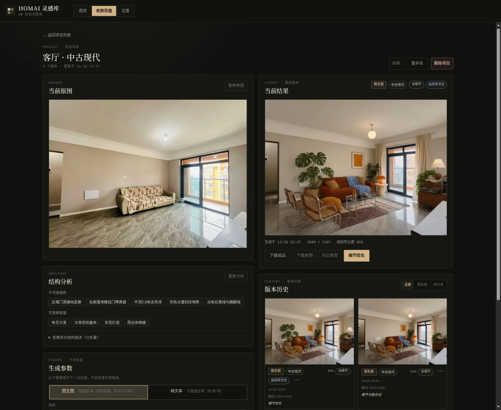

<div align="center">

# HOMAI 灵感图库工作台

**一个本地网页，管图库，也管老房改造出图。**

零第三方依赖（Python 标准库 + 原生 JS，无框架、无构建步骤）。
自带 10 张图库示例与 5 个改造项目，首次启动自动导入，其余留给你自己的模型。

**需要自备一个 OpenAI 兼容的生图模型 Key**——没有 Key 只能浏览示例，不能生图。


</div>


---

## 它能干什么

| 模块 | 做什么 |
| --- | --- |
| **图库** | 浏览空间图、看风格拆解（色板 / 家具 / 灯具 / 织物 / 材质 / 装饰）、按拆解出的提示词原地生图 |
| **老房改造** | 上传一张老房照片 → AI 拆出「不可改结构 / 可替换软装」→ 图生图生成改造效果图 |
| **结构锁定** | 墙体、门窗洞口、层高、地面标高、机位、透视、取景写进提示词硬约束，改的是软装不是结构 |
| **添加细节** | 生成时勾选，AI 在结构不变的前提下补绿植、挂画、织物、摆件；可选填 300 字要求 |
| **细节优化** | 以**当前结果图**为底图再做一轮 img2img，只加装饰、其余不动，产出新版本 |
| **提示词可见** | 「当前结果」标题下的折叠条里能看到该版本实际提交给模型的提示词、负面词与中文补充，可一键复制 |
| **版本管理** | 旧版本永不覆盖，可对比、下载、改备注、删单版；结构符合度自动打分 |

## 自带的示例数据

仓库里的 `demo/` 只有一小套示例，够把界面点亮，不够占满你的硬盘：

| 内容 | 数量 | 说明 |
| --- | --- | --- |
| 图库图像 | **10 张** | 客厅 4 / 卧室 3 / 餐厅 2 / 厨房 1，覆盖 8 种风格 |
| 风格拆解 | 10 条 | 每张图对应的色板、家具、灯具、织物等结构化字段 |
| 改造项目 | **5 个** | 其中一个有 3 个版本，用来演示「添加细节」和「细节优化」 |

首次启动会把示例数据复制到运行时目录（`images/`、`remodel/`、`metadata.json`、
`style/items/`），之后你在界面里的生成结果都写在这些目录里。**其余留空——用你自己的
模型 Key 往里生图就行。**

想恢复成刚克隆的样子：删掉 `images/ai`、`remodel/items`、`metadata.json`、
`style/items` 再重启，示例数据会重新导入。

## 界面

### 图库：浏览、拆解、复现



每个条目带分类、风格标签、拆解出的提示词，以及本地复现图与参考图的对照。
点开可放大：浮层宽度贴合图片、两侧留白，1:1 原始像素在浮层内横向滚动。



### 老房改造：原图 → 结构分析 → 结果





左侧是原图与 AI 拆出的「不可改结构 / 可替换软装」，右侧是最新结果图，
带生成时间、尺寸和结构符合度。

### 对比原图



### 房型识别：餐厅不会被画成客厅

风格包里的家具清单是按房型给的，所以出图前先确定这间房是什么：

1. 「补充要求」里写了房型词（餐厅／客厅／卧室／厨房／书房／卫浴／玄关／阳台）→ 直接按它，
   且这句话不走翻译；
2. 否则看结构分析给出的房型；
3. 否则看项目名（如「餐厅改造」）；
4. 都不行就做一次视觉识别，结果缓存在项目里。

房型只用来决定这间房该配哪套家具清单和配色，不再限制功能或家具改动：
认出是餐厅就按餐厅配家具，但餐桌餐椅本身照样可以换成新的。
「补充要求」里写了房型就直接采用。认不出来的房型只做表面焕新
（材质、颜色、灯光），不换家具——宁可少改，也不猜。

「补充要求」是逐字直译的，不做扩写；译文会回显在结果卡片上
（`补充要求：餐厅 → dining room`），一旦译文出现可疑扩写，自动退回中文原文生效。

### 细节优化：在结果图上做加法



点「细节优化」→ 可填 300 字以内的装饰要求（留空由 AI 自由补）→ 生成新版本。
提示词是收紧的：输入图已是成品渲染图，除了指定的小件装饰，**其他一律不许动**。



上图是实测结果：只多了沙发旁的大型龟背竹和边柜上的台灯，沙发、藤椅、茶几、门洞、
推拉门、地毯叠层全部原样。

### 版本历史



## 快速开始

```bash
git clone <你的仓库地址> && cd homai-gallery-crawler
python3 gui_server.py --port 8765     # 打开 http://127.0.0.1:8765
```

零第三方依赖，不需要虚拟环境，系统自带 `python3` 即可（3.9+）。
想隔离的话也可以 `python3 -m venv .venv && .venv/bin/python gui_server.py --port 8765`。
端口只认 `--port` 参数，环境变量 `PORT` 不生效；要让同 WiFi 的其他设备访问，加 `--host 0.0.0.0`。

启动日志会告诉你导入了什么：

```
已导入示例数据 10 张图库 / 5 个改造项目 / 10 条风格拆解
HOMAI 图库已启动：http://0.0.0.0:8765/
```

打开 `http://<本机IP>:8765/`，到右上「设置」填模型 Key（Base URL 可留空用默认网关），
保存后就能在「图库」和「老房改造」里生图。**没 Key 时只能浏览，不能生图**——
——选型与改法见下一节「模型与 Key」。也可以改用环境变量
`HOMAI_DASHSCOPE_KEY` / `HOMAI_DASHSCOPE_BASE_URL`，优先级见
[docs/credentials.md](docs/credentials.md)。

常驻部署（systemd 用户服务，开机自启）：

```bash
systemctl --user enable --now homai-gallery
systemctl --user status homai-gallery
```

## 模型与 Key（必读）

**这个项目不自带任何模型额度。没有 Key，它只能看图，不能生图。**

没有配置 Key 时：图库可以浏览、改造项目的历史版本可以翻看；但结构分析、图库生图、
改造生图、细节优化、中文补充要求翻译全部失败。具体表现：

- 结构分析：`HTTP 502`，`{"code": "analysis_failed", "message": "未找到模型凭据：…"}`
- 生图任务：`HTTP 202` 受理后立刻转 `error`，`error` 字段同上

### 推荐的模型

项目走 **OpenAI 兼容的 `chat/completions`** 接口，一张图一个请求，图片从响应的
`choices[].message.content[].image` 里取（不是 `/images/generations`）。

| 用途 | 推荐模型 | 要求 |
| --- | --- | --- |
| 出图（图库复现 + 老房改造） | `qwen-image-3.0-pro`（阿里云百炼兼容模式实测可用） | 接受 messages 里的 image part，返回 `content[].image`；图生图要支持传 1 张参考图。单张 3–7 分钟 |
| 结构分析 / 中文翻译 | `qwen4-max` | 必须多模态，能读图并返回结构化 JSON |

换其他厂商的模型前，先确认上面两点满足；只满足文生图的模型只能用「纯文本」模式，
且照样需要支持 `content[].image` 返回格式。尺寸不能指望 `size` 参数单独生效，见下面的比例说明。

### 三种配置方式

1. **界面（推荐）**：右上「设置」填 API Key（Base URL 留空就用默认网关）→ 保存。写入本地
   `credentials.json`（权限 `0600`），下一次模型调用立即生效，不用重启。
2. **环境变量**：`HOMAI_DASHSCOPE_KEY`、`HOMAI_DASHSCOPE_BASE_URL`，优先级高于文件。
3. **手写文件**：项目根目录 `credentials.json`，字段名固定：
   `{"dashscope_api_key": "[REDACTED]", "dashscope_base_url": "https://…/compatible-mode/v1"}`。
   这个文件在 `.gitignore` 里，永远不会被提交。

Key 只存本地：不进 Git、不进日志（日志里只有掩码）、不进报错文案。清除凭据用设置里的「清除本地凭据」。

### 想换模型或改参数

| 想改什么 | 改哪里 |
| --- | --- |
| 生图模型（图库 + 改造共用） | `gui/config.json` 的 `models[0]` |
| 视觉分析模型 | `gui_server.py` 的 `REMODEL_VISION_MODEL` |
| 中文要求翻译模型 | `gui_server.py` 的 `REMODEL_TEXT_MODEL` |
| 可选尺寸下拉 | `gui/config.json` 的 `sizes` |
| 监听地址 / 端口 | 启动参数 `--host` / `--port`，或 `gui/config.json` |
| Base URL | 界面「设置」或 `HOMAI_DASHSCOPE_BASE_URL`（不建议改代码里的默认值） |

改完先跑不花钱的自检，再拿一条文案试纯文本模式（约 80 秒），最后再试图生图：

```bash
python3 test_credentials.py   # 凭据能否解析
python3 gui_smoke.py          # 全链路冒烟，不调用付费模型
```

### 比例：`size` 必须和提示词一起写

只传 `size` 对模型不生效，会出 16:9。代码里已经双写：`1080*1440` 配
`Vertical 3:4`、`1440*1080` 配 `Horizontal 4:3`。自己加尺寸时，务必同时给构图词，
否则界面上看着是竖图，出来的还是横图。

## 目录结构

```
gui_server.py           本地 HTTP 服务：图库 API + 改造项目 CRUD + 生图队列
gui/                    前端（原生 JS，无框架、无构建）
  ├─ index.html         图库与改造两个入口
  ├─ app.js             图库：列表、详情、灯箱
  └─ remodel.js         改造：项目、生成、对比、细节优化、版本历史
demo/                   示例数据（入库，只读）
  ├─ metadata.json      10 条图库元数据
  ├─ images/ai/         10 张图库 WebP
  ├─ style/items|palette  对应的风格拆解与色板
  └─ remodel/           5 个改造项目（item.json + 原图 + 各版本 + 缩略图）
style/style_packs.json  8 套风格包（文本 DNA：配色、家具、灯具、材质）
docs/                   接口、数据模型、凭据、运维文档 + README 截图
images/ remodel/ metadata.json style/items/   运行时数据（不入库，首次启动从 demo/ 导入）
```

## 数据流

```
demo/  ──首次启动自动导入──▶  images/ai/、remodel/items/、metadata.json、style/items/
                                      │
                                      └── 你在界面里的生成结果写在这里（不入库）
```

`.gitignore` 把运行时数据全部挡在仓库外：图片、改造项目、缩略图缓存、日志、Key 都不进 Git。
所以仓库很小，克隆下来只有代码、文档、截图和 26 MB 示例数据。

## 几条设计取舍

- **图片一律本地保存、只经 HTTP 读**：不依赖浏览器自动化，也不需要外部图床。
- **不上传成品图**：示例数据只够点亮界面，真实效果图由使用者用自己的 Key 生成，不占仓库体积。
- **比例靠双写生效**：只传 `size` 对模型无效，必须同时在提示词里写构图
  （`Vertical 3:4` / `Horizontal 4:3`），否则出 16:9。
- **每次生成都是新版本**：旧结果不覆盖，便于回滚和横向比较。
- **Key 只存本地**：`credentials.json` 权限 `0600`，不进 Git、不进日志。

## 测试

```bash
python3 test_credentials.py   # 凭据解析与脱敏，10 项
python3 gui_smoke.py          # HTTP 冒烟（不调付费模型），143 项
```

冒烟覆盖：图库读写与检索、改造 CRUD、生成参数校验（尺寸 / 模式 / 风格）、添加细节与
细节优化入参、提示词英文校验、任务快照字段、示例数据导入幂等、日志不落 Key。

## 文档

| 文档 | 内容 |
| --- | --- |
| [docs/web-gui.md](docs/web-gui.md) | 网页界面：两个入口、区块顺序、灯箱、分析策略 |
| [docs/api.md](docs/api.md) | HTTP 接口：图库、改造 CRUD、任务轮询、细节优化 |
| [docs/data-model.md](docs/data-model.md) | `remodel/items/` 存储结构、字段与不变量 |
| [docs/credentials.md](docs/credentials.md) | Key 怎么填：界面 / 文件 / 环境变量、优先级与安全 |
| [docs/operations.md](docs/operations.md) | systemd、端口排查、超时预算、备份恢复 |

## 已知限制

- 图生图单张约 3–7 分钟（受网关排队影响），纯文本模式约 80 秒。
- 「结构符合度」是模型自检打分，不是像素级配准，90% 以上仍可能有细微位移。
- 工作台**没有鉴权**，只适合局域网或本机；直接暴露公网等于把生图额度交出去。
- 没有 Key 时项目不可用（只能看图）：结构分析、全部生图、细节优化都会报「未找到模型凭据」。
- 示例数据里的图是 AI 生成的示意稿，尺寸已压到 1600 px 以内，方便随仓库分发。

## 许可

代码以 MIT 许可发布，见 [LICENSE](LICENSE)。示例图像与提示词仅作个人学习与风格研究使用。